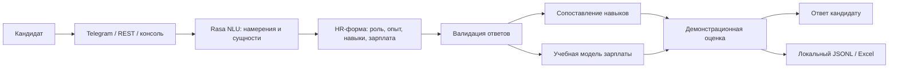

# HR Candidate Assistant

[](https://github.com/Nestorbi219/hr-candidate-assistant/actions/workflows/ci.yml)
[](https://www.python.org/)
[](https://pypi.org/project/rasa/3.6.21/)
[](LICENSE)

**Русскоязычный HR-бот: от первого сообщения до структурированной анкеты кандидата.**

Учебный командный проект на Rasa с Telegram-интеграцией, распознаванием навыков, сопоставлением с требованиями вакансий и демонстрационной моделью зарплаты. Эта версия подготовлена для портфолио на основе [hetiyje/RasaProject](https://github.com/hetiyje/RasaProject).

## Возможности

- Распознаёт намерения и сущности на русском языке с помощью DIETClassifier.
- Собирает роль, опыт, навыки и зарплатные ожидания через форму Rasa.
- Поддерживает пять демо-позиций: Data Analyst, Data Scientist, Data Engineer, MLOps Engineer и Project Manager.
- Нормализует названия навыков и сравнивает их с требованиями; отдельно доступен режим FastText.
- Обрабатывает ответы «6 месяцев», «полтора года», «без опыта», «150к», «150 000» и «1,2 млн».
- Показывает результат сопоставления и сохраняет подходящие анкеты локально в JSONL, опционально — в Excel.
- Работает в консоли, через REST и в Telegram с вашим собственным токеном.

## Мой вклад

**[Nestorbi219](https://github.com/Nestorbi219):**

- Написание скрипта распознавания и сопоставления навыков кандидата.
- Запуск и подключение Telegram-бота.
- Создание test stories для проверки сценариев диалога.

Проект создавался вместе с друзьями. Авторство команды и история разработки сохранены; подробнее — [CONTRIBUTORS.md](CONTRIBUTORS.md). Имена авторов исходных коммитов не переименованы в имя владельца портфолио.

## Как устроен бот



## Быстрый запуск

Нужен **Python 3.10**. Версия Rasa зафиксирована на 3.6.21; Python 3.11+ для этого окружения не подходит. На Mac с Apple Silicon зависимости TensorFlow могут отличаться от Linux; CI проверяет Linux.

```bash
git clone https://github.com/Nestorbi219/hr-candidate-assistant.git
cd hr-candidate-assistant
python3.10 -m venv .venv
source .venv/bin/activate
python -m pip install 'pip<24.1'
python -m pip install -r requirements.txt
rasa data validate
rasa train
```

В Windows используйте `py -3.10 -m venv .venv`, затем `.venv\Scripts\activate` вместо `source`.

Запустите сервер действий в первом терминале:

```bash
source .venv/bin/activate
rasa run actions
```

Во втором терминале, из той же папки:

```bash
source .venv/bin/activate
rasa shell
```

Первое обучение занимает время. Обученные модели и кэш генерируются локально и не хранятся в Git.

### Пример анкеты

| Шаг | Сообщение кандидата |
| --- | --- |
| Начало | `Привет` |
| Анкета | Кнопка «Оставить информацию о себе» |
| Роль | Кнопка «Data Scientist» |
| Опыт | `3.5 года` |
| Навыки | `Python, SQL, Pandas, NumPy, Scikit-learn` |
| Зарплата | `150к` |

Бот покажет заполненную анкету, долю совпавших навыков и прогноз учебной модели. При соответствии демонстрационным условиям запись появится в `runtime/candidates.jsonl`. Для воспроизводимой проверки через REST с явными намерениями см. [docs/demo.md](docs/demo.md).

## Telegram и дополнительные режимы

- [Подключение собственного Telegram-бота](docs/telegram.md).
- [FastText, модель зарплаты и настройки хранения](docs/architecture.md).
- [История улучшений портфолио-версии](CHANGELOG.md).

Локальные настройки можно задать в оболочке:

```bash
cp .env.example .env
set -a
source .env
set +a
```

Приложение читает переменные окружения; файл `.env` автоматически не загружается. В Windows задавайте переменные через PowerShell.

## Структура

```text
actions/                 # Обработчики формы, парсинг, навыки, зарплата, хранение
data/                    # NLU, правила, истории и 20 учебных зарплатных примеров
docs/                    # Архитектура, Telegram, демонстрационный сценарий
tests/                   # Unit-тесты и тестовые истории Rasa
.github/workflows/       # Проверка Python, Rasa и диалогов в GitHub Actions
config.yml               # NLU-пайплайн и политики диалога
domain.yml               # Намерения, слоты, форма и ответы
credentials.example.yml  # Шаблон подключения Telegram без секретов
credentials.yml          # Локальный REST-канал
endpoints.yml            # Адрес сервера действий
models/                  # Генерируемые модели, исключены из Git
runtime/                 # Локальные заявки, исключены из Git
```

## Проверки

```bash
python -m pip install -r requirements-dev.txt
ruff check actions tests scripts
ruff format --check actions tests scripts
pytest -q
rasa data validate
rasa train --fixed-model-name demo
rasa test core --stories tests/test_stories.yml --model models/demo.tar.gz --fail-on-prediction-errors
```

CI запускает unit-тесты, проверку конфигурации, обучение Rasa, тестовые истории и полную анкету через REST с работающим сервером действий. Rasa 3.6 может выдавать предупреждения, что `utter_ask_*` не используются в историях: эти ответы вызываются самой формой. Для локальной проверки полной анкеты используйте [REST-сценарий](docs/demo.md).

## Ограничения

Это демонстрационный проект, а TechNova Solutions — вымышленная компания. В модели зарплаты используются **20 иллюстративных записей из исходного проекта**; её качество на реальных данных не измерялось. Прогноз не является оценкой рынка труда. Сопоставление навыков и пороги принятия анкеты — учебные эвристики, решение о найме принимает человек.

JSONL и Excel подходят для локального демо. Для нескольких процессов и промышленной эксплуатации нужны база данных, контроль доступа и отдельная работа с данными кандидатов. По умолчанию бот не запрашивает Telegram username и не отправляет заявки настоящему рекрутеру.

## Лицензия и происхождение

[MIT](LICENSE) — для кода проекта; лицензия добавлена с разрешения участника команды. Сторонние библиотеки и предобученные модели распространяются на собственных условиях. FastText-веса не включены в репозиторий.

История исходного проекта перенесена с сохранением авторов и дат. Перед публикацией из истории удалены кэши, бинарные модели и токены Telegram, поэтому идентификаторы исходных коммитов изменились. Исходный репозиторий не изменялся.
